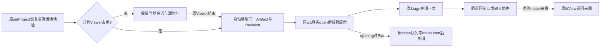

# Reader 自动恢复与原退出回程 · 2026-10-20

## 结论

已补齐三个实际接缝：等待中的已保存 Reader 会在现有 Viewer 关闭后自动继续；恢复阅读关闭时沿准确原节点执行原 fitView；原 Viewer 在正文二次 opening 阶段也接受 Esc，用户不用等动画猜时机。

10/17“启动映射未就绪导致永久旧 body”的窄修原本已在源码。本轮真实整页确认它已生效，没有重复冒领这项实现。

## 改动与流程

- `native-reader-recovery.tsx` 仅订阅 foreign occupied 边界；自己 loading/open 不会触发清理并取消 lease。现有 pending、导图草稿、跨现场与输入归属保护保持。
- 原 Stage 已先处理返回来源窗口/输入，再把已恢复 Reader 的准确 native readerSource 交给原 API。核 Project、Canvas、API、Artifact/View 引用；不填假旧 refs、不改节点、不新增相机。
- 成功解码的版本写回既有 `readerLastRevisions`。文字 body 原本已有记忆，本轮 Host 将这一连续性覆盖到其它格式与统一成功读取阶段；显式 Revision/View 始终优先。
- 原 `c2` 键盘回调只为 LCOS controlled session 的 opening+Esc 调既有 `runtime.close` 排队。普通原 Viewer、open/inspect、嵌套事件已消费、全屏规则保持；无全局 keydown listener。

## 文件

1. `lab/pilot/native-reader-recovery.tsx`
2. `lab/pilot/native-material-viewer.tsx`
3. `lab/native-reader-recovery-source-transform.mjs`
4. `lab/native-material-viewer-transform.mjs`
5. `scripts/native-reader-recovery.test.mjs`
6. `scripts/native-reader-recovery-browser.mjs`
7. `scripts/native-material-viewer.test.mjs`
8. `scripts/native-reader-gallery-escape-browser.mjs`

未改 Core、平台、Drop、Collection 实现、vendor 原件或 56241 数据。以上之外仅本轮证据与本文。

## 真正执行的验证

| 验证 | 结果与证据 |
| --- | --- |
| 原恢复等待反例 | 修前真实组件+原wa复现：已有Viewer关闭后没有自动恢复。`旧Reader独立委托/2026-10-19T20-10-10-051Z/report.json` |
| `node scripts/native-reader-recovery.test.mjs` | 19项 PASS；准确历史/草稿版、启动映射、自动继续、返回一次、错误版本/源地址/API拒绝、输入草稿保护。`旧Reader独立委托/2026-10-19T20-28-20-772Z/report.json` |
| `node scripts/native-reader-recovery-types.test.mjs` | 严格目标类型检查0错，依赖/全仓检查不冒充。`旧Reader目标类型检查.json` |
| 原恢复整页 | PASS：准确历史FileRecord、原wa open、刷新、旧持久源地址保留、Esc关闭一次、准确来源定位、真实Composer草稿/caret保留；Graph/Runs/Presentation/三Canvas完全不变。`旧Reader真实恢复/2026-10-19T20-28-50-756Z/report.json` |
| `node scripts/native-material-viewer.test.mjs` | PASS：普通donor路径AST等价、原其它声明未改、7组实际原键盘回调、准确版本/编辑恢复策略 |
| `native-reader-gallery-escape-browser.mjs` | PASS：真实物理Esc捕获时phase=opening且insideViewer=true，原Viewer关掉、Gallery保留，再Esc逐级关Gallery。`output/playwright/reader-gallery-escape-20261020/2026-10-19T20-26-04-191Z/report.json` |
| 完整UI构建 / diff检查 | 隔离实例完整构建及后续UI-only构建通过；git diff --check通过 |

Reader项证据目录前缀：`output/原生文件Drop整合_20261017i/`。

整页准备：仅在新建 `isolated-reader-restore-20261020` 用原 Core PUT 把合成文本推进一次，以取得真实 superseded 历史版本；随后恢复脚本不转发任何业务写入。Gallery Esc 另创建一份合成未投影正文和集合。准备记录在该runtime的 `reader-fixture-intent.json`、`reader-fixture-receipt.json`、`gallery-fixture.json`，未碰用户项目。

## 失败也留着

- 首次冷 course 资产转换超过旧脚本 route.fetch 30秒；后将该测量限时设60秒，没有改产品加载行为。
- 旧脚本误断言 finishClose 必须 phase=closed，厂商实际空闲是 open/null；修正观察断言后继续真测。
- 真测又发现原 Stage 关闭发 unprojected、没有来源节点；对应 `20-10-41-157Z` 报告保留，随后接回真实native来源。
- 新拒绝用例曾把“更新但仍准确的当前API”误当无效；改测真正不可用API。旧lease异步API变化仍由原测试验证拒收，没有放宽产品保护。`20-26-46-479Z`失败报告保留。

## 边界与回滚

- 19项组件测试使用实际组件/原wa，Core读端和动画回调为受控peer；不能替代已单列的真实浏览器证据。
- 有未完成草稿、未知保存或确定跨现场的恢复仍保留旧body；未声称12类旧窗口全部迁移。
- Gallery早Esc测试只延迟准确文件GET以稳定落入真实二次opening，不注入运行时phase或直接close。
- UI变更重建对应隔离UI即可；原资产键盘变换需要重启该实例服务，UI-only不会重载Node已import的transform。
- 本轮56253当前child PID34860，runtime不变；停止前重新核对owner。
- 回滚只撤销本轮8文件的精确差异，再重建/重启对应实例；无需Schema迁移，不回滚并行Drop/Collection修改。不提交、不push。
