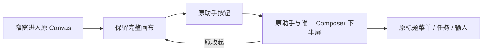

# Shell 窄窗与入口精简 · 2026-10-20

## 结论

已在原 TapNow 框架内完成一轮减法。360px 默认画布恢复为 360×800；助手按需打开后在下方占 360×400，画布仍保持完整宽度。原菜单、任务返回、收起、草稿、Ctrl+滚轮和桌面拖宽均真实通过。

## 范围与流程

原流程：窄窗加载 → 桌面最小侧栏自动打开 → 画布宽度为 0 → 用户先手动收起。

新流程：窄窗加载 → 默认完整画布 → 原助手按钮按需打开下半屏 → 原收起返回完整画布。

- 原 Ks/Le 仍持有开闭状态。仅 <=640px 的初始值与访问次数自动展开被抑制，不改用户持久偏好；显式打开/关闭仍走原 setter。
- 桌面 hD resize、宽度持久化、原动效仍在。窄屏 CSS 让该原 Frame 固定在下半屏，不再占 flex 画布宽度。
- 标题已经打开同一个 Rp 历史菜单，因此移除旁边重复历史图标；原任务、历史行、新会话、刷新与放到画布动作仍沿标题菜单及原按钮。
- 去掉助手中央重复空态输入提示，保留唯一 Composer placeholder。
- 移除顶栏积分、社区、云分享三处当前离线未接槽位；保留本地 JSON 导出、其它已接菜单与所有原 Viewer/手势。
- 关闭折叠助手建议泡的数据请求：该建议原本写旧 xn 输入 owner，未接当前 Core Composer；原助手按钮保留。

## 修改文件

- lab/native-shell-controls-transform.mjs：精确变换原 Shell 显示槽与原开闭默认。
- lab/native-chat-frame-transform.mjs：在既有资产变换入口调用上述变换。
- lab/native-chat-controls-transform.mjs：唯一标题历史菜单。
- lab/pilot/native-chat-ui.tsx：移除重复空态。
- lab/pilot/native-chat-ui.css：窄屏下半屏适配。
- scripts/native-chat-controls.test.mjs：更新唯一历史入口断言，保留完整动作验证。
- scripts/native-chat-controls-browser.mjs：旧双入口回归改为重复打开同一标题菜单；需要旧合成历史/任务数据，本轮未复跑此整套脚本，已做语法检查。
- scripts/native-shell-controls.test.mjs：默认/显式开闭/持久化/原 owner 保留测试。
- scripts/native-shell-narrow-browser.mjs：真实浏览器回归。

未修改 server.mjs、Core、Drop、native-file、厂商原件或用户数据库。并行任务修改另计。

## 真实验证

| 命令/场景 | 结果 |
| --- | --- |
| node scripts/native-shell-controls.test.mjs | PASS：窄屏/桌面默认、用户偏好不被响应式覆盖、显式开闭、原 owner 不变、商业槽与未接建议 |
| node scripts/native-chat-controls.test.mjs | PASS：原标题历史菜单、真实 Conversation/Run 回调、任务状态和错误分支 |
| node scripts/start-full-integration.mjs --port=56251 --runtime-label=isolated-shell-narrow-20261020 --native-rail-pilot | PASS：完整 UI/配套隔离 Core 构建并启动 |
| node scripts/native-shell-narrow-browser.mjs --base-url=http://127.0.0.1:56251 | PASS：6组真实 GUI 操作、无 pageerror、无任务业务写入、无建议 API 请求 |
| git diff --check | PASS（只有仓库既有 CRLF 提示，无差异错误） |

浏览器证据：output/playwright/shell-narrow-20261020/report.json 和 01–05 PNG。

- 默认/刷新360px：Canvas=360×800，bodyWidth=360，助手关闭，无横向页面溢出。
- 原按钮打开：助手=360×400，y=400；上半画布 Ctrl+滚轮可用。
- 标题菜单/Escape、任务/返回：唯一 Composer 保留草稿。
- 收起/重新打开：草稿保持。
- 桌面1440px：Canvas=1080×900，原右栏=360×900；拖宽后仍保留同一输入，再回360px画布宽仍为360。
- 云分享只读核对：GET /api/canvas/v1/canvases/surface-core-main/shares → 501 Local API endpoint is not implemented。
- 积分只读核对：GET /api/bff/billing/init → billingState=not_connected、fixture-only、billing_connected=false。

首次浏览器脚本误把普通滚轮当缩放，超时失败经过记录在 first-attempt-note.md；首次原 JSON 被复跑覆盖，不冒充仍保有原报告。查原手势代码后改成既有 Ctrl+滚轮，产品手势没有改。

## 边界、风险与未完成

- 只证明本轮 Shell 和指定原交互；不代表统一 Drop、整产品或全部失败路径已经验收。
- 640px 是本轮响应式阈值；手机软键盘/真实触控未验。
- 商业入口仅因当前本地能力未接而收掉。以后真接云分享/账户需恢复已验证的入口；原厂 owner 函数未删除。
- 源变换沿用安装版精准接缝；厂商 bundle 升级须复跑定向测试。
- 未运行整个历史全量测试链；本轮使用定向真实行为测试和完整 UI 构建。
- 未 Commit、未 Push、未新分支。

## 运行与回滚

本轮独立实例：http://127.0.0.1:56251/canvas/surface-core-main；runtime isolated-shell-narrow-20261020，启动时 child PID37344。停止前核对实际 PID owner。

回滚仅撤销上述本轮文件及既有文件的精确差异，重新构建对应隔离 UI 并重启其 asset transform 进程；不回滚任何并行 Drop 变更，不改运行数据库。无需 Schema 迁移。
