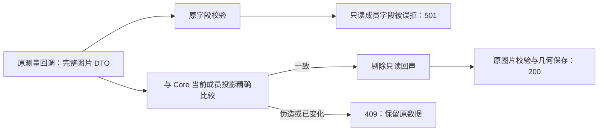

# 图片首屏测量保存 501 修复 · 2026-10-20

结论：真实原页面的图片测量已从 501 恢复为 200，375×250 显示尺寸刷新后保留。图片来源、准确版本、成员关系和文件原字节没有被改写。

## 原因与实际范围

TapNow 原图片测量回调把完整 GET 节点 DTO 送回 `nodes:batchActions`。DTO 新增的 `lcos_workspace_membership` 是只读成员投影，但旧图片字段校验不认识它，导致合法 `__metadata` 与尺寸一起被拒绝。

修改仅落在 `lab/pilot/surface-core-facade.ts`：GET 与更新回声共用 `projectedWorkspaceMembership`；更新时先对照真实 Core 行核对 workspace/view/addedAt/addedBy，再剔除这个未变化的只读字段。原尺寸、图片来源、版本和像素 metadata 校验继续运行。没有放宽任意 data，没有修改原参考源码或跨现场 Drop。

## 文件

- `lab/pilot/surface-core-facade.ts`：26 行新增、8 行删除；成员投影与回声接缝。
- `scripts/native-image-measurement-echo.test.mjs`：真实独立 Core 的请求/保护回归。
- `scripts/native-image-measurement-browser.mjs`：独立 runtime、临时端口、真实 Chrome 页面验证。
- 本 Markdown 归档。

## 命令与真实结果

| 检查 | 结果 |
|---|---|
| `node scripts/native-image-measurement-echo.test.mjs` | 通过；先保留 501 失败复现，修复后 13 条请求验证通过 |
| `node scripts/native-workspace-membership.test.mjs` | 已有 6 组成员竞争、撤销/恢复回归通过 |
| `node scripts/native-image-measurement-browser.mjs` | 通过；原首屏完整 DTO 保存 200、reload 几何保存 200；页面异常 0 |
| 两个脚本 `node --check` | 通过 |
| `git diff --check -- lab/pilot/surface-core-facade.ts` | 通过；仅有仓库既存 LF/CRLF 提示 |

保护回归包含：伪造 workspace/view/actor/timestamp、未知成员字段、已移除成员；改源地址、Revision、像素尺寸仍 409；改标题和未知 data 仍 501。拒绝发生在几何写入前。没有通过测量恢复已删除成员。

## 证据

- 失败复现：`output/图片测量保存修复_20261020/core-2026-10-19T19-43-03-030Z.json`
- 最后 Core 通过：`output/图片测量保存修复_20261020/core-2026-10-19T19-48-40-848Z.json`
- 实屏报告：`output/图片测量保存修复_20261020/browser-2026-10-19T19-45-41-643Z/report.json`
- 首屏截图：同目录 `01-first-load-measurement-saved.png`
- 刷新截图：同目录 `02-reloaded-measurement-persisted.png`

所有写测均使用本轮新建数据和端口；未写 56241。测试服务器已按 PID/脚本/label/端口核对归属后关闭，独立测试 runtime 已清理，output 证据保留。

## 限制、下一步与回滚

- 实屏未找到原鼠标 resize 句柄，因此只声明自动测量、真实保存和 reload 已验；任意鼠标 resize 未验证。
- 原 platform config、plugins、voice capability 各自仍有 501，不属于本次图片保存错误，未修改。
- 成员关系确实在读取后改变时仍返回 409；需要刷新后继续，不能把旧快照写回。
- 根任务整体重启后可在当前验收页面复验；本子任务未替换根任务运行实例。
- 回滚只需撤回本次 facade 接缝与两测试脚本；无 Schema、数据库迁移、数据重写或新依赖。
