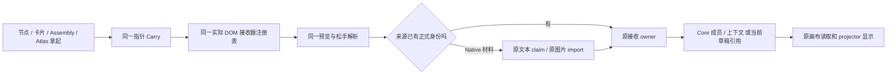

# GEN2：各节点接入同一套 Drop（2026-10-10）

## 本轮目的

用户要求的是节点之间直接协作，不是只修 Rail，也不是给每个功能加一个目的地选择器。沿原 T3 / T2 规划和 Gen1 已成熟操作，接收动作由已经看见的对象决定。

当前工作区：`E:/TRAE项目/LCOS0.1收口/LCOS_GEN2_GUI_RECOVERY_20260926`。源码改动保留在原工作区，没有提交或推送，没有覆盖其它聊天的未提交内容。

## 对用户来说发生什么

| 拿起什么 → 放到哪里 | 应当发生的结果 | 本轮状态 |
| --- | --- | --- |
| 材料 → 集合本体、展开集合、Atlas 集合、Rail 上的该集合 | 加入同一个真实集合，原材料保留 | 已接；图片 / 原生 Note / 原生图片真实提交成功 |
| 材料 → Context / Workflow 聚合节点 | 加入该对象对应的空间，不是弹目标选择 | 已接；工作流真实提交与刷新回读成功；画布 consumer 已实现并通过集成验证，fixture 子现场无 canvas，未冒称子现场 UI 手测 |
| 材料 → Glyth 本体 | 保存到该会话的长期上下文 | 真实提交与刷新回读成功 |
| 材料 → 已打开的 Composer | 加入本次输入引用，不直接发送 | 晚挂载接收区已修；真实鼠标松手 success，精确 View / revision 加入草稿，源几何不变；未提交 Run |
| 工作流卡 → Composer | 沿既有方法读取入口取用已保存步骤 | 真实预览已通；当前示例卡没有步骤，松手如实拒绝且不改草稿；不冒称方法取用成功 |
| Context / Workflow 聚合 → 支持它的空间 | 以准确 Scope 引用进入，源对象不消失 | 既有接收 owner 已连；精确 Scope 成员显示走原 batch，集成验证通过 |
| 长期现场 → 支持它的空间 | 保留真实 Workspace 身份，复用 Portal 显示与进入 | 收到的 Workspace 走原 batch、binding、Portal；自动测试通过，不造第二种现场入口 |
| 集合 → 另一个集合 | 真实集合嵌套引用 | 已接；Atlas 实鼠标精确预览，未假写成功 |
| 集合 → Rail 空白接收区 | 加入它自己的入口 | 复用既有精确 Rail 引用写入；按用户裁决不自动收录所有集合 |
| 材料 / 一组选中材料 → Rail 新现场区 | 保留源，创建含这批材料的现场，点击可进入 | 复用上一轮已交付链；首次 Native 材料接入已统一到同一入口 |
| 普通左拖 | 原生移动、选中、吸附、撤销 | 保留原 owner，不启动远程语义投递 |
| 右拖 / Alt 拖 / 拿取把手 | 同一虚影、预览、松手交付 | 所有上述来源复用同一套已有指针与 Drop 注册体系 |

材料包含有真实 Artifact / View 身份的文本、图像、文件、PDF、PPT、音视频、网页及结果材料。这里不把任意两个材料之间的拖放解释为覆盖文件；接收对象只执行自己已经获批的用途。

## 这次修的实际断点

1. Context / Workflow 节点本体没有自然接收区。
2. 同一集合切到另一 Surface 后丢失接收能力。
3. Atlas 的聚合卡和 Assembly 的真实集合行没有接入同一个拿取入口。
4. 三个根现场按钮位于 `PortalDropWorkspaceProvider` 之外，看见按钮却取不到真实接收地址。
5. Atlas 的透明遮罩挡住现场按钮。只在实际 Carry 时提高接收按钮层级，普通浏览保持原有层级。
6. Composer 先运行 effect、后挂载 Portal 内引用 DOM，导致界面已出现但没有注册任何 Composer 接收区。改为 DOM ref 自然注册/注销，未给 store 补假状态。
7. Native Note 的闲置正文仍是 `contenteditable`，原获取规则把整个正文一律屏蔽。现在闲置正文可拿取，聚焦编辑器继续保留文字选择/菜单，普通表单按钮不被抢。
8. Native 材料首次取得 Core 身份的链之前仅服务 Rail 新现场，集合、会话、输入框等无法复用。现在沿原文本 claim / 图片 import producer，完成真实来源准备后，回到同一个接收器的原 owner。
9. 材料准备阶段与展开集合近场摆放脱节。保留原 Native 几何验证，只用本次真实登记回执映射成员身份，不伪造图片 binding。
10. Core 的 Presentation 成员表和画布 projection consumer 脱节。补读准确 Scope / capability 的成员，沿已有 projector 产生新增显示；不依据胡乱的标签猜身份，不把全项目灌入各现场。

## 一条链到底

这不是新平台、新 store、新 runtime、新后端模型或新验收门禁。所有实质写入仍由各自现有 owner 负责，Source、Core 与 Huabu 的职责保持原分工。

## 源码落点

以下路径相对当前 Gen2 工作区。

- 来源与登记：`huabu/apps/web/src/lcos/drop/resolveNativeMaterialSources.ts`、`readNativeImageMaterial.ts`、`nativeCanvasDropGeometry.ts`、`lcosRecognizers.ts`。
- 同一松手与执行：`drop/dropIntentResolver.ts`、`drop/dropCommitRouter.ts`、`drop/dropReleaseConsistency.ts`、`LcosHostOverlay.tsx`。
- 节点自然接收：`nodes/LcosSpeciesBodies.tsx`、`nodes/nodeMembershipDropTarget.ts`。
- Atlas、现场按钮、Assembly：`surfaces/context/ContextAtlasDropCard.tsx`、`ContextAtlasStage.tsx`、`shell/LcosSurfaceDock.tsx`、`shell/surfaceDockDrop.ts`、`shell/LcosProjectShell.tsx`、`professional/AssemblyBody.tsx`。
- 输入框：`composer/LcosComposerHost.tsx`，现有 `drop/workflowMethodDrop.ts`。
- 收到之后的显示：`apps/web-gen2/src/spatial/worksiteProjectionInput.ts`、`reconciliationRunner.ts`、`host/projectionFacade.ts`、`backend/projects.ts`、既有 `nodes/PortalNodeBody.tsx`。
- 仅拓宽既有手势 payload：`apps/web-gen2/src/interaction/semanticDropMachine.ts` 的 Native 图片来源字段；没有数据库迁移。

## 明确没有假接的地方

1. **真实 Collection 整体 → 会话 / Composer / Scope，目前后端与输入引用契约仍缺该实体的直接通道。** 不能把新 Collection ID 塞进旧 collection-Scope 分支。已支持集合嵌套、Atlas 拿取和 Rail 收录，但这不等于集合整体上下文引用完成。
2. **Native 图片永久绑定原载体仍缺原子 claim producer。** 现有绑定 PUT 是覆盖写，不能冒充 claim-if-empty。当前读取真实图片，复用既有导入和字节去重；本次手势可以交付，原图片不被抢绑。验收样本 `reused=true`；全新图片字节的重复投影问题不能借这个样本宣称已解决。
3. **向已有集合追加多项只有逐项 owner，没有批量原子 append。** 已保留逐项回执和部分完成，不把客户端循环写成一个事务。
4. **示例工作流的已保存步骤为空。** 已验证方法的真实取用路径会明确拒绝，而非把空卡显示成“已成功装上方法”。
5. **当前 Context Atlas 没有真实 Context 卡，部分工作流 Workspace 尚无 canvas。** 已有针对同入口的行为测试，但没有伪造卡或画布冒充整条手测。
6. **Assembly 多选行尚未作为一个整组 Carry 来源。** 本轮补齐真实集合行的拿取；没有把旧的底部多选 Apply 按钮算成整组拖放。Portal 节点本体可以接收，其专业预览窗口仍只读。

## 原件与证据

- 原交互依据：`E:/TRAE项目/LCOS0.1收口/_cabin/08_MD原件包与单件/LCOS_Gen2_T3_TO_T5_全范围_Exact_Interaction_Blueprint_20260907.md`，尤其 Drop 与 Conversation / Composer 段。
- T2 / T3：`TO_T2_T3_C2-4A_RailwayReceive_DropDestination_Contract_Response_20260907.md`。
- Gen1 真实参考：`review/LCOS_Gen1_Drop_Rail整套对照_20261009/runtime/Gen1_3e99769`，对应成熟源码，不把当前旧 Alpha checkout 当 Gen1 成熟版。
- 本轮材料、节点、Atlas 专项和真实鼠标证据：`E:/TRAE项目/LCOS0.1收口/review/LCOS_Drop整体完善_20261010/`。其中 `12_真实拖放验收.md` 记录实际 Core 回执、刷新回读及仅清理本人测试内容的结果。

## 验证与回滚

| 检查 | 本轮真实结果 |
| --- | --- |
| Drop 来源、手势、成员、松手、反馈和三个导航生产端 | 27 文件、211 项 PASS |
| 节点自然接收与 Assembly 相关 | 45 项 PASS |
| Dock / Atlas | 27 项 PASS；真实鼠标预览、命中和取消通过 |
| web-gen2 全包（包含中央画布消费者） | 796/796 PASS；其中新增 12 条精准成员 / 旧锚点边界案例 |
| Portal / 原 seam | 17/17 PASS |
| Composer 晚挂载与原引用行为 | 2 文件、8 项 PASS，局部 lint 0 warnings；真实材料本次引用 success，方法无步骤时真实拒绝 |
| web-gen2 typecheck | PASS |
| Huabu 最终 production build（含 tsc） | PASS；保留构建工具对 highlight、既有依赖注释、动态导入及大块产物的提示，不顺手改依赖 |
| Root 修改的共享 Drop / Host / Shell 文件 lint | PASS，0 warnings |
| 本轮修改文件 diff-check | PASS；Git 仅提示少数原 CRLF 文件以后转 LF，无空白错误 |
| 最终完整刷新 Main | pageErrors=[]；原图片 / Note 坐标与大小未变；临时图片残留 0 |

统计是各分区各自的检查集合，存在重叠，不相加冒充总测试量。最终源码集合包含所有本轮已完成改动；未运行全仓 lint，不把局部 lint 写成全仓零警告。

Composer 完整证据位于 `review/LCOS_Drop整体完善_20261010/06_Composer真实浏览器与DOM接收修复.md` 及其 `output/playwright/composer/readback.json`。真实鼠标成功后自己的本次草稿和输入已经清空。该子任务的普通左移只验证实际 Move / Drop 未启动，持久化请求为数据保护而中止，因此不计 Move 持久写入的浏览器 PASS。

保留现有安全规则、失效检查和真实失败态。只在当前有源码改动的 owner 跑必要验证，不新增通用 gate。

回滚按本文件列出的改动逐文件审查反向补丁，不使用 reset 清理并行工作区；Core / Native 不需要数据库迁移或数据重建。本人测试新增的成员和上下文已通过现有可撤销操作清理，原项目和源材料保留。
