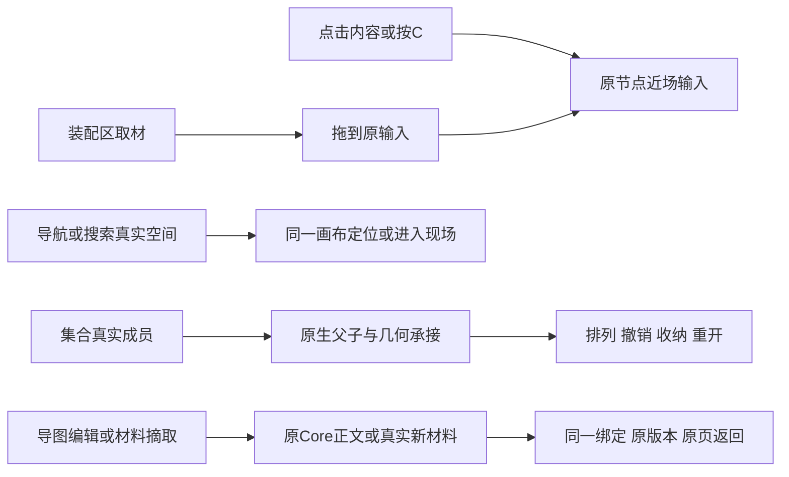

# Main 成熟 Gen1 交互承接 — 2026-10-08

## 结论和范围

> **2026-10-09 用户手测纠偏**：本稿不证明真实按键和Rail已完全齐平。后续发现普通左RF Move仍无条件arm远端Give、Assembly/Workflow仅默认左HTML投递、Rail全量manager及手牌吞原输入，现已按用户明确Gen1右默认实际修复并重新测鼠标路径。最新回传：`E:/TRAE项目/LCOS0.1收口/review/LCOS_Rail_RightDrop纠偏_20261009/00_本轮交付.md`。普通左保留native机械、右/Alt/明确把手共用携带，非目标取消不刷红toast；空方法工作流仍列真实缺口。下文是10月8日时点记录，不能覆盖该最新事实。

先对齐成熟 Gen1 主界面的基础体验，再继续 Gen2 专属设计。本轮按真实生产代码补齐：内容近场输入、原输入装配、集合排布与开收、完整空间导航、文本/F2/大纲导图、额外材料 View、关系编辑、实际格式阅读和普通网址入场。仍有公开 producer 与运行覆盖缺口，不能据此声明整个 Gen1/Gen2 完全齐平。

Gen1 主源是已有 Git 对象 `3e99769bf106d68cecc54094662352bfaecf2bdd`。完整主界面 App/ProjectCanvas 与实际 caller、集合/材料、节点/输入三份对标原件，均在下列报告目录。旧工作树 `950acba9` 未替代成熟源；未修改 Gen1、后端、数据库 Schema 或上游 Huabu 仓库。

报告目录：`E:/TRAE项目/LCOS0.1收口/review/LCOS_持续UX收口_20261008/`。

## 用户操作变化

没有新增目的地选择步骤。普通移动、项目材料入场、引用与持久投递继续使用各自原来的真实语义。已有节点/人工几何不因为重开或元数据更新被重新排列。

## 实际承接与修改模块

- `Canvas.tsx`/`lcos-seam`：稳定内容 click、已有文本创建口、已有 DataTransfer consumer、managed text intrinsic height；不建立第二 Canvas/camera/history。
- `composer/*`/`LcosShellStore`/`ProfessionalWindowStage`：同一近场输入、实测量测避让/动效、普通空白退出、装配/引用保持、返回原输入聚焦、exact sourceLocator 与来源 Reader 返回。
- `nodes/collection*`/`CanonicalCollectionView`：真实成员进入旧空 host，沿既有 placeNodesInFrame/geometry batch 和一次 Undo；开收 transient motion、不抢共享父框；冷读与保存副本删除拖动/resize瞬时字段。
- `nodes/creation`/`nodes/text`：同一 carrier 接 Core canvas-text；manual F2；成熟 outlineTree/MindMapEditor/中文自然尺寸机制；CtrlD/CV 走既有 ArtifactView，不复制材料 truth。
- `navigation/*`/`shell/LcosRailway`：完整 Scope/Collection/Workspace 索引、Whole Where、真实 CtrlK 操作、弹性双列/隐藏恢复、原 MiniMap species/beacon 与 locator cluster/fan。
- `professional/reader*`：选定 Revision/FileRecord 真实 Blob 按 MIME 分派；pagus PPT SVG、react-pdf 真页、真实 page transfer/source evidence；HTML 实际预览。
- `drop/materialTransferIngress`/`canvasUrlIngress`/`projectUrlImport`：原文件、剪贴板图片、纯文本与页摘取接已有 Core producer；普通 URL 接既有 resources/import-url，真实链接而非伪造网页正文。
- `apps/web-gen2/{host,spatial,presentation,backend}`：精确 Resource URL facts、初始入场位置、额外 View、关系重接/删除；bindings-before-census 修正误删刚创建绑定的 race。
- `ConversationWorkViewBody`：复用现有 session.conversations client，不直接另建同领域 client。

全部修改文件与 ADOPTED/READ_SOURCE/生产 caller 保留在各功能报告，不把上述摘要当替代施工卡。

## 真实验证

- 集合同一旧空 host：11/11，3个原成员、无重叠、一次真实 Undo、240ms motion、减少动态效果、刷新保持；最后原人工坐标恢复。共享/嵌套仅行为测试，未假装全部真实场景覆盖。
- 原失败文本 carrier：身份、正文保存、F2、导图改字/Tab/分支复制、保存与 reload；没有重建替代样例。
- 额外 View：CtrlD真实新增 View 与独立 binding，保留原材料/原版本；关系创建、EdgeArc重接、键盘 Delete、reload不复活，201/200/200。独立浏览器 CtrlC/V 未单列，实际 caller 和同 producer 测试通过。
- 近场输入与 Assembly：稳定单击不抢焦点、C明确聚焦、真实动效、原对象避让、仅一个原输入，普通退出保留草稿，装配保持。
- 导航：真实集合搜索/Where 2/2、CtrlK fit/settings/Reader/Esc、Rail键盘双列、隐藏后仍可搜索并恢复、音频物种小地图与定位 beacon。多目标 cluster/fan 没有本轮真实 fixture。
- 材料：HTML、PPT、PDF真实导入/字节渲染，页拖出进入 Core、来源证据、原版本第2页、返回摘取窗口，3条完整链通过，pageerror0。
- URL：同一链接保存、重复入场复用原Artifact/View/carrier、href、reload 3条通过，pageerror0；不声称获取了网页正文。
- web-gen2 全量784/784。Huabu最终全量2524通过/1失败（410文件）；唯一失败是 Milkdown 嵌套列表空行格式，原HEAD转换器+原断言在本机同一7.22.1依赖也复现。本轮不改原格式，也不声明7.21.1结果。
- 两侧 typecheck通过；生产 build通过。受影响实现的 targeted lint通过；部分旧测试非空断言 warning 保留。diff-check没有空白错误。

日志与截图：报告目录 `browser/`、仓内 `output/playwright/nav-main-20261008/`。全量测试结束后 Vitest有happy-dom teardown挂起噪声，结果完整保留，没有算成全绿。

## 原生设置 / 对话待办

> 最新Rail接收联动结果（2026-10-09）：`E:/TRAE项目/LCOS0.1收口/review/LCOS_Rail_RightDrop纠偏_20261009/06_接收地图联动.md`。已补临时可读接收地图、源pointer capture下的Peek、预览本体接收、跨邻居停留宽限、收下后固定预览锚点和回执/原watch成员刷新；真实Core applied/already-member/reload及节点/相机保持均复查，测试变化已安全恢复。只有取消/hover的旧证据不能替代这条实际接收链。

已写入 `docs/construction/HUABU_RETIREMENT_LEDGER.md` 的 2026-10-08 条目：设置与原生对话换 LCOS 产品外壳、去除面向用户的 Huabu logo/品牌混用，保留许可归属和现成能力。功能上需明确原生 thread/profile 与 Core Receiver 的身份关联、显式引用、实时执行/产出归位、三现场线程/草稿连续性。现有归档/关联旧会话不等于实时 producer 已接通。

## 实际边界和下一步

Collection业务更名/删除、Scope业务删除缺公开 producer；导航隐藏不冒充业务删除。混合native+Core整组复制、跨项目复制暂不作成功声明。精确正文section/line自动定位、原生实时到Core执行/产出也未闭合。Context深层编辑/Workflow作者链与新仪器按用户顺序排在 Main 基础之后。

当前预览：`http://127.0.0.1:5175/projects/lcos-gen2-dev/main`。Core/原生服务仍使用原数据；服务中断恢复时必须保留5175允许来源。只加确切本地来源，未知来源仍403；不移除已有保护、不使用通配来源。

未 commit、未 push；保留其他执行者的后端/Reader未提交改动。回滚仅按报告列出的本轮新增/薄接缝撤回，不 reset、不删项目材料/人工位置。完整大白话对照、source落点和剩余接口见报告目录 `10_Main齐平_整合交付.md`。
