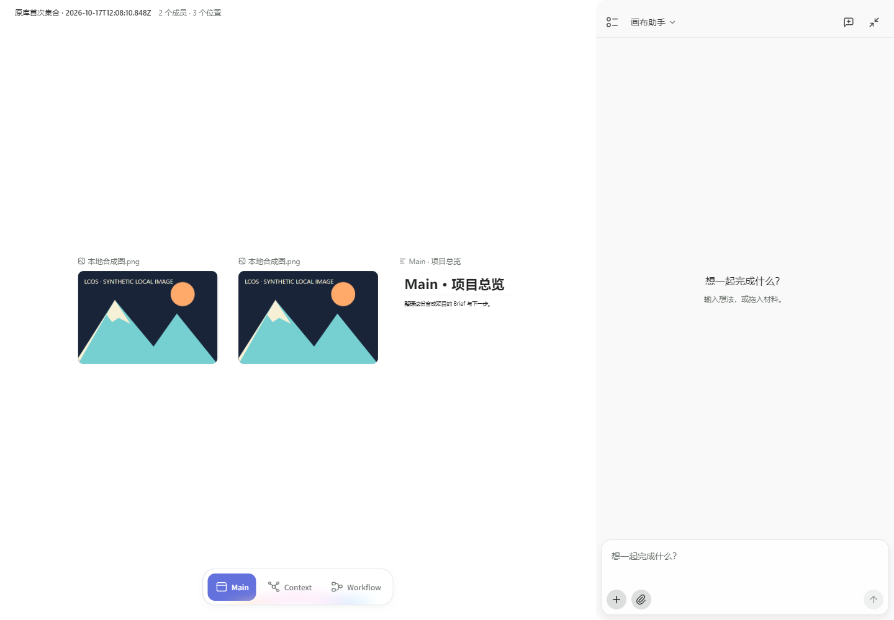

# 原生 Color Pin 与素材库恢复：施工及真实验证

结论：Color Pin 已沿 TapNow 原节点色点、顶栏组按钮和原菜单接入真实 Core；完整原页面指定路径通过。原库 pending/unknown 整库关开及共享成员 Gallery 读路径，已在最终构建完整复验通过。**这只证明指定流程：旧 GN2 页面、会话入口胶囊、原建议旁路和全区排版仍有明确缺口，不认定 GUI 已融合。**

工作区：`E:/Codex 项目/LCOS夺舍计划_20261013`。当前候选为 [56239 Main](http://127.0.0.1:56239/canvas/surface-core-main)，runtime `isolated-native-flow-20261017c`，服务 PID **32252**、隐藏 launcher PID **17704**。最新完整构建已含共享 Gallery、原 Dock 小地图避让与 Run 重试改接。此前 28820/5532 为历史实例；重启前分别核验准确进程，不清理或重造运行数据。

## 接在原体系的什么地方

| 功能 | 原入口与承载 | 实际业务与返回 |
| --- | --- | --- |
| 节点多色标记 | 原 `Dg → Hie/jie/Lie/Gie`，原节点标题 marker `n5/Iie` | Graph、binding、原节点确切引用核对后，对准确 ArtifactView 增减 Core membership；已有 entity 共享标记保留读取，节点色点只修改本位置 |
| 顶栏颜色组 | 原 `v7 → w7布局 → y7 → m7` | 单一共享 Context 提供 Core 快照；原组按钮、hover/press、原弹层和筛选 owner 保留，没有旧 ColorPinHud |
| 原组菜单命名 | 同一个 `m7` 行内输入与原键盘流程 | 原 definition 主键不变，旧 label/updatedAt CAS；原事务和 ChangeSet 撤回/重做；页面显示项目共享，失败保原输入 |
| 定位 / 下载 / 移除标记 | 同一原组菜单及 `p7/g7` | 当前原 API 的准确节点定位；确版 FileRecord 下载；原确认框只移除捕获范围内 membership，不删除节点或 definition |
| 原库关开后的放置结果 | 原 `wt`（原 `mO` store）及原 `Zp/TS` | transient 状态仍归原素材库 store；关闭原预览或整库后保 pending/unknown，核对只 GET。没有第二个库 store、持久账本或假 Drop 手势 |
| 同材料不同 View 的详情 | 原 Artifact Tools 的实例选择 | 项目、Artifact、View、Revision、FileRecord 与本实例 serial 同时核对；旧详情卸载不再清掉新详情的选择 |

唯一 Pin Provider 包在原 `eG` 返回树外，覆盖互为兄弟的原画布 `BC=bB` 和顶栏 `H7`；不是只包 Host 或 Canvas 内一块。原整个返回树、节点/相机/高亮/小地图 owner 保留。原小地图实际 Pin paint、桌面 pan/zoom 与窄窗 Dock 避让有分项证据；默认右栏占满和建议 bubble 覆盖仍未解决。

## 已执行的验证

- 完整构建和最终 UI 重编通过；后端 typed client、Core 事务、路由与源码变换均实际入包。**未运行全仓库 tsc，不宣称全仓测试通过**。
- [Color Pin 后端](./ColorPin后端施工.md)：真实隔离 Core，包括准确 View、多色、自定义 hex、foreign 拒绝、CAS 并发、事务回滚、原 ChangeSet 撤回/重做。
- [原节点与共享状态](./ColorPin前端原色点.md)：最终节点 13 组、真实 Core 4 组、实际原 Popover 3 项。已补迟到旧 GET、明确 4xx 拒收、写后读取失败、同现场换 API 保 pending/unknown；不把换 API 的预检 0 写冒充恢复通过。
- [原组菜单与确版下载](./ColorPin原组菜单.md)：9 组实际原函数/生产适配测试，原命名失败保稿、准确下载及原定位。受控测试与真实浏览器分开。
- [原库与完整 Artifact Tools 恢复](./原库放置恢复验证.md)：真实原 mO initializer、Zustand、Collection Detail 和完整 Artifact Tools；实际生产 client。关开恢复均 POST1/flush1；不同 View、同源双实例、旧 cleanup、props 变化前一拍均有修前失败与修后通过。
- [真实 Chrome 下载边界 19 项](./诊断下载边界验证.md)：同源 Blob + 明确非空 download 真下载且字节一致；远程、其他协议、无下载属性的 Blob 仍拦。修的是原导航拦截器误拦文件下载，未移除远程保护或放行 window.open Blob。
- 原库 context 组合、Collection 首投客户端、真实 Core 材料投放专项通过。相关命令为 `native-library-contexts.test.mjs`、`native-library-collection-placement.test.mjs`、`native-material-placement.test.mjs`。

## 完整原页面证据

| 场景 | 结果与准确范围 |
| --- | --- |
| [最终 Color Pin 完整链](./原色点整页/2026-10-17T11-33-44-913Z/report.json) | **PASS**。真实原节点 Popover → POST201 成功后丢回包 → Escape/重开禁色点 → 显式 GET 核对（总1 POST）→ 原组菜单 PATCH200 改名 → 真实 `Text.md` 下载且字节与确版 FileRecord 一致 → 原成员定位 → 原确认 DELETE200。7 项完整领域/空间事实前后一致，0页面错误/非法写/模型调用。最终 membership 清除，definition 保留。 |
| [下载修复后的既有标记复验](./原色点整页/2026-10-17T11-32-28-381Z/report.json) | **PASS**，只读重开既有标记 → 真实下载/定位/原确认移除。只1 DELETE，不重发此前 assign 或 rename；不能单用这条代替完整链。 |
| [原小地图实际 Pin paint](./原色点整页/2026-10-17T11-42-50-138Z/report.json) | **PASS**，原 UVe tooltip 开图→原组打开→按真实目标坐标对应原 SVG rect，实际 computed fill/stroke 均为准确 `#F0606B`，随后原下载/定位/移除通过。先前脚本误匹配4个controls、又误测原0.3秒transition第一帧的失败均保留；修的是定位和实际稳态测量，未关闭动效或改产品颜色。平移/缩放/窄窗另验。 |
| [原库 pending/unknown 整库关开](./原库关开真实页面/2026-10-17T06-25-47-330Z/report.json) | 该分支已通过：首投请求在到达 producer 前 hold，关整库重开仍禁首投；提交后丢回包，关开仍只有核对；总1 POST/5 GET。旧详情无法迟到发布，新入口 GET 恢复唯一 carrier。但后续新集合点不开 Gallery，**全报告 passed=false，未改成绿色**。 |
| [首次 Pin 下载失败](./原色点整页/2026-10-17T06-29-54-754Z/report.json) | 原 assign/loss/GET/rename 已执行，但原导航拦截器拒绝 Blob 下载；UI 当时误报已下载，浏览器没有事件。失败保留，修后两次真实文件下载分别留新报告。 |

原页面全部由真实鼠标/键盘操作，无隐藏 store setter。Playwright Core 为当前环境没有 Browser 工具时的本地替代，浏览器使用 fresh context；远程 HTTP/WS 均阻断。测试只使用隔离合成材料，没有真实 provider、模型、账户或密钥。

[原小地图手势分项](./小地图真实手势验证.md)有桌面开关、鼠标平移、原 Canvas Ctrl+滚轮及680px结果。最终32252的[360/320原页复验](./Dock小地图原页复验.md)已证地图与 Dock 开关避让/回位、原三键保留，真实 `rf__minimap` 间距12px（外框11px），八份完整响应不变。**layoutPassed=true，wholeFlowPassed=false，总passed=false**：默认展开右栏仍令Canvas宽0，“看看下一步做什么”bubble仍盖住地图，未接suggestions POST严格abort；没有借几何通过洗绿整个流程。

[旧 Run 重试改接](./旧任务重试改接施工.md)已完整构建：打开 nextRun 沿同原右栏并保 sourceRun 返回地址，旧 retry 动作和旧本地表单保留。源码与实际 React 目标测试通过；没有旧 Stage 全生命周期 GUI 证明。当前入包 caller 已由8降为7；Collection三处、旧Assembly三处、旧Collection入口一处和12类Stage仍在，不能把少一次openWindow说成旧窗退役。

## 新抓出的 Collection 缺口

同一 Canvas 的多个 Core Collection 可以引用同一 Artifact，但原 TapNow Pile 的 `Ri` 将每个空间节点分配给一个字典序最小的 pile。当前三集合 raw memberIds 同为3，实际原 `Ri` 输出 A=0、B=3、C=0；原 `yFe` 对空 displayMembers 直接拒绝打开 Gallery。这是原空间排他与 Core 逻辑集合不等价，**不是鼠标点错，也不是换个 CSS 可以修**。

[归档事实执行原函数的诊断](./共享成员Pile只读诊断.json)已复现，修复沿原 `yFe/FVe/LVe/tFe` 按准确 canonical 成员与真实 occurrence 读取；原 `Ri` 物理归属不动，不重 parent、不删节点、不造 View。[完整源码与11组专项](./共享成员Gallery_诊断与施工.md)保留修前事实，后补真实整页见下文。**Gallery 内拖出/回堆重排仍缺准确空间提交，阅读通过不替所有空间动作销账。**

## 最终构建补验：共享成员与未投影阅读

| 真实原操作 | 结果与限制 |
| --- | --- |
| [复验旧失败的 Collection C](../原生库集合整合_20261017g/原库真实页面/2026-10-17T12-03-12-572Z/report.json) | **PASS**。沿同原库打开同一个旧 C，再进原 Gallery，准确2逻辑成员/3真实位置；0 producer POST，7份完整事实不变。没有创建替代集合或移动旧空间节点。报告因既有脚本目录规则存于g目录，但测试的是最终h构建。 |
| [首投 pending → 关整库 → 丢回包 → 再关开 → Gallery → 刷新/1000px](./原库关开真实页面/2026-10-17T12-08-10-735Z/report.json) | **PASS**，最终32252。同一真实生产请求共1 POST/6 GET；旧预览卸载后的结果不串入新实例，显式核对复用唯一 carrier。准备仅新增1个声明的合成 canonical Collection，成员来自既有材料；真实投影才写准确成员/空间，未建新材料或 Run。06:25旧失败仍保留，不改原报告。 |
| [未投影成员 → 同 Gallery“查看”→ 原 Viewer → Escape回同 Gallery](./未投影成员原阅读/2026-10-17T12-05-38-284Z/report.json) | **机制 PASS**。真实 FileRecord 字节一致、没有为阅读创建 View/节点，关闭后原 Gallery 仍在；阅读前后7份事实不变。**所选材料是会话入口胶囊，其内容语义仍不适合用户，不能写成会话阅读已完成。** |

亲看最终 Gallery 截图：正常态只有顶部一行 caption，保留原三个卡片；没有另挂成员 inspector。但正文摘要很小、留白仍多，**信息密度和阅读层级尚不能判成熟**。

## 新发现：文件读取正确，用户阅读对象却错了

上述未投影 Artifact 的正文来自真实导入服务自动生成的“会话入口文件”：来源、消息数、章节、内容hash及“原消息在时间线数据库”。用户想看对话，看到的是内部存储说明。这正是本次全区审查要抓的**桥接未做、内部机制直接露出**，不因组件属于原 Viewer 就合格。

已按真实 `ConversationSession.conversationArtifactId` 与 `ConnectedConversation.conversationSessionId` 追源，不按标题或正文正则识别。当前 session/messages/export 可随续聊变化，而旧 entry Revision 没有准确的导入 snapshot 关联，直接改开当前 U5 会偷换确版语义。需要分别定义“查看当前会话”和“阅读该次导入的历史消息”，沿原右栏只读模式/原 Viewer 对应内容位承接，保留原 Composer receiver、草稿和请求；没有能力的历史关联留册，不删hash文本掩盖问题。

## 事实保持与剩余事项

- [28820 完整构建重启](./重启事实核对_28820.json)：Graph、Runs、Presentations、bindings 与三 Canvas 7 份全响应相同。
- [5532 下载复验重启](./下载复验重启事实核对_5532.json)：上述7项相同，先前准确 Pin definition/membership 也完整保留；没有重造测试现场。
- [最终32252加载前](./Gallery加载前事实_5532.json)与[加载后](./Gallery加载后事实.json)：Graph/Runs/Presentations/bindings/三Canvas/Pin共八份完整响应均相同。
- 当前构建旧窗口 caller 为 **16文件31调用，实际组合变换后入包7处，旧 Stage 12类 body**。[逐调用去向](../原流程融合_20261017c/当前旧窗口caller核对.md)。这是源码残留数量，不是7个都已实屏触发。
- 还没完成：Gallery Core 拖出/重排和复杂成员；partial 原处恢复；材料创建与 Core 一致 Undo；全类型 Drop；跨重启 unknown/草稿；动态子现场；旧 Stage 恢复及局部输入迁移；任务详情/等待回答/产物卡内部硬搬；真实会话入口阅读；默认窄窗与建议 owner；全区密度、浅色材质、焦点与动效。不能删入口、丢状态、去掉报错或正则清正文冒充完成。

完整目标保持 active；本报告只是实际进展与未完账。未新增 hash、冻结 contract、baseline 或 gate，未发布、push 或修改厂商原件/原 GN2 工程。
