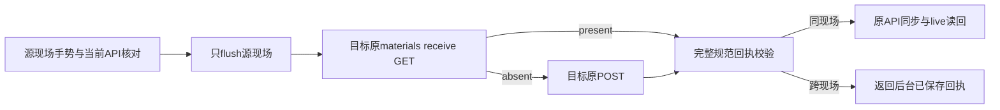

# 跨现场材料接收客户端 · 2026-10-20

结论：已按最小接缝区分源 Canvas 与目标 Canvas，旧同源调用行为保留。只改 `lab/pilot/native-material-receive-client.ts` 和 `scripts/native-material-receive-client.test.mjs`。

## 变更

原来：目标 Canvas 也必须是浏览器当前 Canvas → 保存当前 API → GET/POST 接收 → 同步当前 API。

现在：可选 `sourceCanvasId`，默认仍为 `canvasId`。源 API/current/编辑快照/flush 始终绑定源地址；GET/POST 与完整 canonical receipt 验证仍绑定目标 `canvasId`。跨现场目标已在后台保存后，不调用源 synchronizeMaterialProjection，也不要求源 liveNodes 出现目标节点；之后沿目标原加载呈现。

- `sourceCanvasId` 不进入 API query/body。
- 原 Presentation/成员/Binding/Canvas/Node/Artifact/View/Revision/位置校验全部保留。
- 丢回包维持 unconfirmed；恢复只 GET，不重复 POST、不 flush。
- 未改后端、Router owner、UI 组合、目标选点或其它执行者文件；没有新增平台、Schema、hash 或 gate。

## 验证

- `node scripts/native-material-receive-client.test.mjs`：19 组 PASS。包含全部原同源/Glyth案例、新增 Context/Workflow 未挂载目标、无目标同步接口、源画布只 flush、输入地址异步变化、源节点不变、远端丢回包 GET-only、新 signal、源 Canvas/API/edit 变化、10类目标回执错配、只读 present/absent/partial、空源地址拒绝。
- 严格 TypeScript 定向检查：实际客户端 + 实际 native-canvas-port + 安装版 React 类型，0 errors；既有纯 MJS 精度助手 allowJs，未冒充全仓 tsc。
- `git diff --check`：通过，仅仓库 CRLF 提示。

证据：同目录 `report.json` 和 `strict-types.json`。

## 边界与下一步

测试运行实际客户端构建产物，但 transport/Canvas publication 是受控测试 peer；这不是原 GUI 鼠标或真实 Core 跨现场验收。Root 正在接调用端与目标布局，需继续实屏证明源不动、切目标看到节点、重复不复制。

只需撤销上述两个文件的本轮差异即可回滚；旧调用不传新字段即保持同源路径。未提交、未推送。
